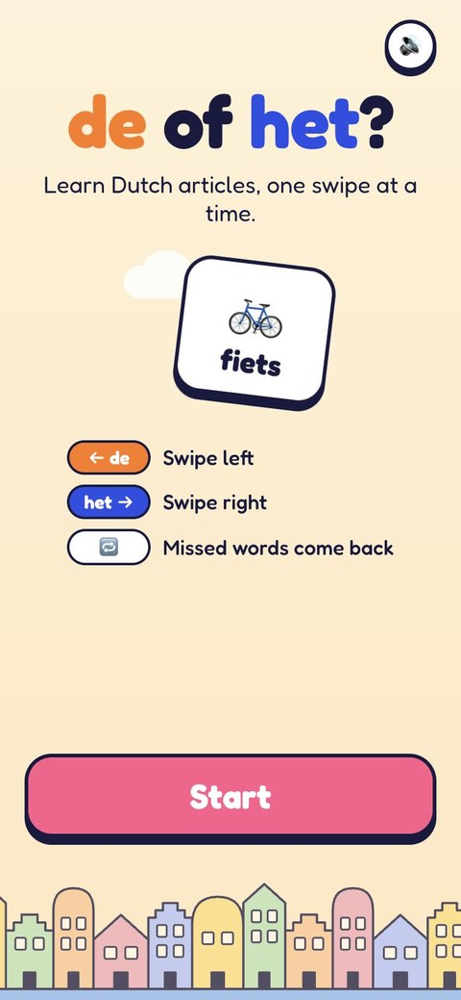
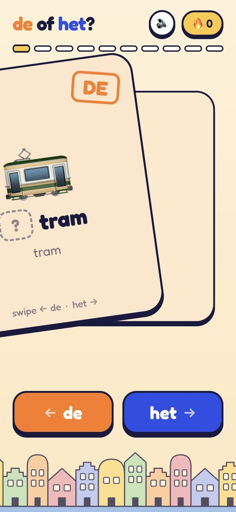
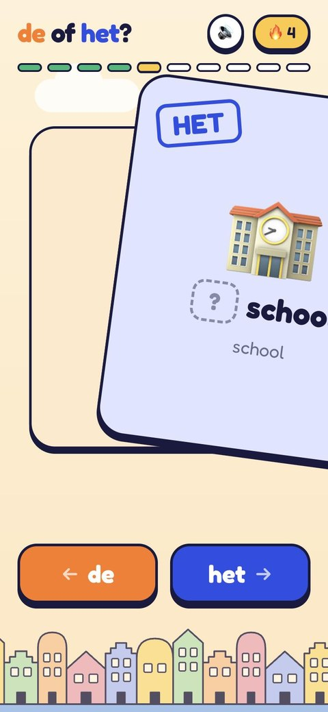
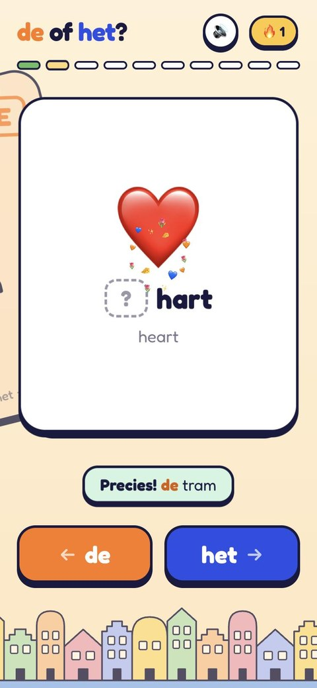
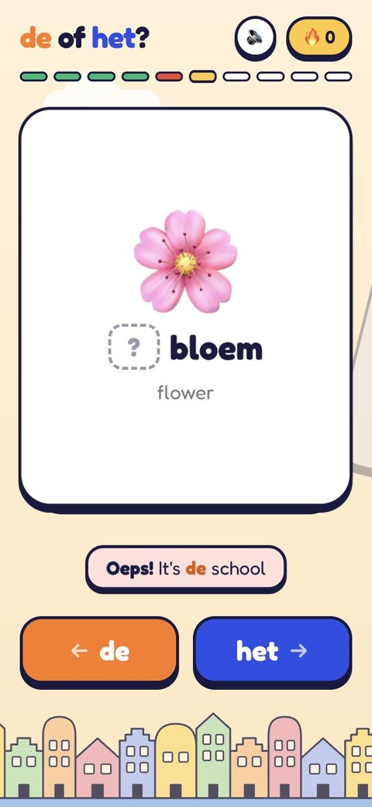
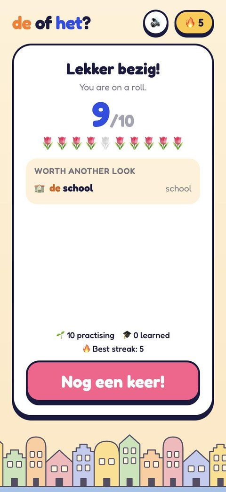

<h1 align="center">De of Het? 🌷</h1>

<p align="center">
  A small swipe game for learning Dutch articles.<br />
  A noun appears on a card. Swipe left for <strong>de</strong>, right for <strong>het</strong>.
</p>

<p align="center">
  <a href="https://de-of-het-nu.vercel.app"><strong>▶ Play it: de-of-het-nu.vercel.app</strong></a>
</p>

<p align="center">
  <a href="https://de-of-het-nu.vercel.app">
    
  </a>
</p>

## Why

Every Dutch noun is either *de* or *het*, and there is no reliable way to guess which. Learners end up memorising each word with its article. This game turns that into short rounds of quick decisions, and brings back the words you missed until they stick.

## Features

- **Swipe, tap or use the arrow keys.** One decision per card, no typing. While you drag, the card tilts and a stamp shows which article you are about to pick.
- **Spaced repetition.** Words move through five boxes: a correct answer promotes a word, a wrong one sends it back to the start. The gap before a word returns grows from 1 to 16 rounds.
- **1500 words** from the most frequent Dutch nouns, introduced in order of frequency. Each has an English meaning and, for about 280 of them, an emoji.
- **Rule hints.** After a wrong answer, words with a reliable ending (-je, -heid, -teit, -tie, -ing and a few more) show the rule behind them.
- **Sounds you can switch off.** Generated in the browser with the Web Audio API, so there are no audio files. The choice is remembered.
- **Your progress stays on your device.** No account and no backend; it lives in `localStorage` and can be reset from the start screen.
- **Respects reduced motion** and works on phones and desktops.

## Screenshots

<table>
  <tr>
    <td align="center"></td>
    <td align="center"></td>
    <td align="center"></td>
  </tr>
  <tr>
    <td align="center">Start</td>
    <td align="center">Swipe left for <strong>de</strong></td>
    <td align="center">Swipe right for <strong>het</strong></td>
  </tr>
  <tr>
    <td align="center"></td>
    <td align="center"></td>
    <td align="center"></td>
  </tr>
  <tr>
    <td align="center">Right answer</td>
    <td align="center">Wrong answer</td>
    <td align="center">Round result</td>
  </tr>
</table>

## Built with

React 19, TypeScript, Vite and [Motion](https://motion.dev) for the animations. The type is Fredoka. Hosted on Vercel; there is no server code.

## Running locally

```bash
npm install
npm run dev
```

Other scripts: `npm run build` (type-check and production build), `npm run lint`.

## Project layout

```
src/
  components/   Cards, start and result screens, sound toggle, decorations
  data/         words.json, generated, and the types that wrap it
  game/         Round building, spaced repetition, suffix rules, sound
scripts/
  build-words.mjs   Generates src/data/words.json
  curated.json      Hand-checked articles, meanings and emojis
  blocklist.json    Words to leave out
```

## The word list

`src/data/words.json` is generated, not written by hand:

```bash
npm run build:words
```

The script downloads two open datasets into `scripts/.cache/` (about 260 MB, not committed), picks the 1500 most frequent Dutch nouns that have a single unambiguous article, and writes each with an English meaning and a level from 1 to 3 by frequency.

Two files in `scripts/` steer the result:

- `curated.json` fixes an article, meaning or emoji for a word, and rescues good nouns the automatic rules would skip, such as words that are also a verb form. `"pinned": true` moves a word to the front of the list.
- `blocklist.json` lists words to leave out.

After a run, `scripts/.cache/report.txt` lists every skipped candidate and why.

## Data sources

- Articles and meanings: [Wiktionary](https://en.wiktionary.org), through the machine-readable extract at [kaikki.org](https://kaikki.org/dictionary/Dutch/). Licensed CC BY-SA 4.0 and GFDL.
- Word frequencies: [FrequencyWords](https://github.com/hermitdave/FrequencyWords) by Hermit Dave, based on OpenSubtitles 2018. Licensed CC BY-SA 4.0.
- Emoji names: [unicode-emoji-json](https://github.com/muan/unicode-emoji-json).

The word list was checked by hand but not by a native speaker. If you spot a wrong article or meaning, please open an issue.
